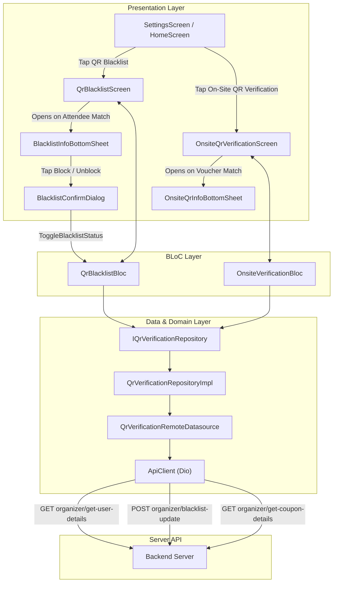

# End-to-End Analysis & Implementation Specification: QR Blacklist & Onsite QR Verification Modules

> **Target Project**: `eventxpro-organiser-app` (Flutter 3.x / Dart / BLoC / Clean Architecture)  
> **Reference Production Project**: `eventxpro-manager` (React Native / Redux / Custom Hooks)  
> **Document Purpose**: Complete architectural, functional, API, UI/UX, and implementation guide for porting the QR Blacklist and On-Site QR Verification modules from production React Native to Flutter.

---

## 1. Executive Summary & Production Overview

In EventXPro, access control and security are mission-critical. While standard entry gates process fast automated check-ins/check-outs, organizers and security teams require two specialized workflows on the ground:

1. **QR Blacklist Module**:
   - Provides security personnel and event managers with real-time capability to scan any attendee badge (or input a ticket ID) and inspect their complete profile (photo, ticket tier, seat, contact info, last check-in session, and session access permissions).
   - Allows authorized admins/staff to immediately **Block (Blacklist)** or **Unblock** an attendee with an optional reason note.
   - Prevents blacklisted attendees from gaining access across all other check-in gates and sessions.

2. **On-Site QR Verification Module**:
   - Validates on-site promo codes, partner/exhibitor vouchers, and registration coupons.
   - Decodes whether a scanned voucher QR has been redeemed, how many attendees redeemed it, their status (`new`, `used`, etc.), who created it, and redemption timestamps.
   - Handles single or multi-user voucher redemption via an interactive carousel.
   - Identifies unused or invalid codes with high-visibility feedback.

---

## 2. Reference Implementation Analysis (`eventxpro-manager`)

### 2.1 File Map in React Native
| Feature | Screen File | Hook / Logic File | Modal / Bottom Sheet |
| :--- | :--- | :--- | :--- |
| **QR Blacklist** | `src/screens/Scanner/BlackList.jsx` | `src/screens/Scanner/useQrBlackList.js` | `src/components/modal/BlackListInfoSheet.jsx`<br/>`src/components/modal/ConfirmModal.jsx` |
| **On-Site QR Verification** | `src/screens/Scanner/OnsiteQrVerification.jsx` | `src/screens/Scanner/useOnsiteQrVerification.js` | `src/components/modal/OnsiteQrInfoSheet.jsx` |
| **QR Verification (Attendee)** | `src/screens/Scanner/QrVerification/QrVerification.jsx` | `src/screens/Scanner/QrVerification/useQrVerification.js` | `src/components/modal/AttendeeInfoSheet.jsx` |

---

### 2.2 Deep-Dive: QR Blacklist Module

#### A. Entry Points & Permissions
- **Entry Location**:
  - Profile Screen (`src/screens/Profile/Profile.jsx` L158-181).
  - Also mapped to Event Navigation (`src/Navigation/EventNav.jsx` L138) and Main Stack Navigation (`StackNav.jsx` L140).
- **Access Guard**:
  ```javascript
  (userDetails?.isAdmin || eventDetails?.permission?.blacklist_permission) && !offlineMode
  ```
  - Only visible if the organizer user has `isAdmin == true` OR the event permissions map has `blacklist_permission == true`.
  - **Online Only**: Restricted when the app is in `offlineMode` because blacklist operations are authoritative server operations.
- **Route Parameters**:
  - `id`: Event Primary Key (`eventDetails?.event?.pk`).
  - `name`: Event Publish Name (`eventDetails?.event?.publish_event_name`).

#### B. Scanning Workflow & Dual-Input Support
1. **Camera Scanner**:
   - Uses `react-native-vision-camera` with `useQrCodeScanner` looking for `['qr', 'ean-13']`.
   - Responsive layout: Square viewfinder (portrait width * 0.62; landscape height * 0.55).
   - Mode Toggle (`SwitchBtn`): Staff can toggle off camera to conserve battery and rely exclusively on hardware laser scanning.
2. **Hardware Laser Scanner (Honeywell / Zebra DataWedge)**:
   - Android DataWedge broadcast intent listener (`isDataWedgeIntents`).
   - Hidden off-screen `TextInput` with auto-focus to catch keystroke-wedge inputs from USB/Bluetooth or integrated scanner engines without raising the virtual soft keyboard (`showSoftInputOnFocus={false}`).
3. **Throttle & Scan Suppression**:
   - When a code is detected, a 4000ms delay (`scanWaitingRef = true` with 4s timeout) prevents duplicate rapid firing.
   - Sets `isScanLoading = true` (displays modal spinner overlay).

#### C. API Contracts for Blacklist
##### 1. Fetch Attendee Details:
- **HTTP Method**: `GET`
- **Endpoint**: `organizer/get-user-details?event_id=${eventId}&ticket_id=${scannedTicketId}`
- **Headers**: `Authorization: Bearer <token>`
- **Response Structure (200 OK)**:
  ```json
  {
    "status": true,
    "message": "User details fetched successfully",
    "user_details": {
      "user_image": "/media/profiles/attendee_123.jpg",
      "firstname": "John",
      "lastname": "Doe",
      "arabic_name": null,
      "company_name": "Acme Global",
      "unique_id": "URN-982143",
      "seat_no": "A-12",
      "display_ticket_code": "VIP-001",
      "country": "United Arab Emirates",
      "email": "john.doe@acme.com",
      "display_ticket_name": "VIP Delegate",
      "ticket_type_cat": "Delegate",
      "blacklist_status": false
    },
    "last_checkin_session": "Main Stage Opening",
    "last_checkin_time": "10:15:00",
    "session_access": [
      {
        "title": "AI Keynote 2026",
        "start_tm": "11:00",
        "hall_name": "Hall 1"
      },
      {
        "title": "VIP Networking Lunch",
        "start_tm": "13:00",
        "hall_name": "Hall 3"
      }
    ]
  }
  ```

##### 2. Update Blacklist Status:
- **HTTP Method**: `POST`
- **Endpoint**: `organizer/blacklist-update`
- **Headers**: `Authorization: Bearer <token>`, `Content-Type: application/json`
- **Request Body**:
  ```json
  {
    "ticket_id": "PBOHTNBTVWS3I===",
    "blacklist_status": true,
    "notes": "Security incident reported at gate 3"
  }
  ```
- **Response Structure**:
  - `status == 200`: `{ "status": true, "message": "Attendee blacklisted successfully" }`
  - Error: `{ "status": false, "message": "Failed to update blacklist status" }`

#### D. Bottom Sheet UI (`BlackListInfoSheet.jsx`)
- Height: 300dp (expandable scroll view).
- Header:
  - Green `#23A618` header with User icon, title `"Badge Information"`, and close (`X`) button.
- Profile Section:
  - Avatar: Circular image loaded via `MEDIA_URL + user_image`, or initials circle fallback (e.g. `"JD"`).
  - Name: `firstname + ' ' + (lastname || '')`.
  - Metadata Rows: Company name, Ticket ID (`unique_id`), Seat Number, Display Code, Country, Email.
  - Ticket Category Tag: Rounded badge (`ChipTail`).
- Check-in & Access Section:
  - Last Check-in Tag: `"Last Checkin: [session] at [time formatted h:mm A]"`.
  - Session Access Pills: Chips displaying session title, start time, and hall name.
- Action Button:
  - If `blacklist_status == true` (Attendee is currently blocked):
    - Color: `#2E7D32` (Green)
    - Label: `"Unblock"`
  - If `blacklist_status == false` (Attendee is currently active):
    - Color: `#D32F2F` (Red)
    - Label: `"Block"`
- Confirmation Dialog (`ConfirmModal.jsx`):
  - Tapping Block/Unblock opens a modal:
    - Title: `"Are you sure to block?"` / `"Are you sure to unblock?"`
    - Icon: Green Check / Red Alert.
    - Notes Field: Multiline text input for reason notes.
    - Action: Submits `organizer/blacklist-update`, triggers success toast, resets note field, and closes sheet.
- Continuous Scanning:
  - If staff scans another badge while the sheet is currently open, `scanQr` intercepts the new code, fetches the new attendee, and updates the sheet seamlessly.

---

### 2.3 Deep-Dive: On-Site QR Verification Module

#### A. Entry Points & Permissions
- **Entry Location**:
  - Event Dashboard (`src/screens/Events/EventDashboard.jsx` L438-447):
    - Tile: `"On-Site QR Verification"` with icon `"VScan"`.
- **Route Parameters**:
  - `id`: Event PK.
  - `name`: Event publish name.

#### B. API Contract for On-Site QR Verification
- **HTTP Method**: `GET`
- **Endpoint**: `organizer/get-coupon-details?coupon_code=${scannedCode}`
- **Headers**: `Authorization: Bearer <token>`
- **Response Structure (200 OK)**:
  ```json
  {
    "status": true,
    "message": "Coupon details retrieved",
    "coupon": {
      "promocode_type": "Exhibitor Guest Pass",
      "code": "TESTSPEC",
      "total_uses": 5
    },
    "redeemed_users": [
      {
        "user_image": "/media/profiles/u1.jpg",
        "ticket_state": "new",
        "used_dt_tm": "2026-10-30T14:30:00Z",
        "user_info": {
          "firstname": "Sarah",
          "lastname": "Connor",
          "company_name": "Cyberdyne Systems",
          "designation": "Operations Director",
          "email": "sarah@cyberdyne.com",
          "mobile": "+971501234567",
          "unique_id": "URN-55421",
          "exhibitor_name": "Tech Corp Stand A10",
          "created_by": "Organizer Admin"
        }
      }
    ]
  }
  ```

#### C. Bottom Sheet UI (`OnsiteQrInfoSheet.jsx`)
- Height: 400dp.
- Header:
  - Green `#23A618` header with User icon, title `"On-Site QR Information"`.
  - Counter text in header: When `redeemed_users.length > 1`, displays `"1 / 3"`, `"2 / 3"`, etc.
  - Close button ('X').
- Content States:
  - **State 1: Unused Voucher (`redeemed_users.length == 0`)**:
    - Clean empty card displaying `"QR Code Unused"`.
  - **State 2: Single User (`redeemed_users.length == 1`)**:
    - Profile card with avatar / initials.
    - Name: `firstname + ' ' + lastname`.
    - State Badge:
      - If `ticket_state?.toLowerCase() === 'new'`: Green pill (`#EAF6EA` bg, `#23A618` text).
      - Other states (`used`, `cancelled`): Red/Orange pill (`#F6EEEA` bg, `#DE4B3B` text).
    - Metadata rows:
      - Company, Designation, Email, Phone, URN, Exhibitor Name, QR Type (`promocode_type`), Created By, Used On (`DD MMM, YYYY hh:mm A`).
  - **State 3: Multi-User Voucher (`redeemed_users.length > 1`)**:
    - Horizontal swipeable `PageView` with page snap.
    - Swiping pages updates the header counter (`${currentIndex + 1} / ${users.length}`).
    - Paging dot indicators at the bottom of the card.
- Feedback:
  - Success sound on code match (`successSound.mp3`).
  - Danger sound on invalid code or API failure (`errorSound.mp3`).

---

## 3. Target Project Architecture (`eventxpro-organiser-app`)

The target project is a production Flutter application structured with **Clean Architecture + BLoC**:
- `lib/core/`
  - `config/app_constants.dart`: API endpoints, brand theme colors, timing constants.
  - `network/api_client.dart`: Centralized `Dio` client with Bearer auth, token refresh, and error formatting.
  - `utils/app_toast.dart`: Toastification wrapper (`AppToast.success(...)`, `AppToast.error(...)`).
  - `services/audio_feedback_service.dart`: Native audio playback (`AudioTone.success`, `AudioTone.error`).
  - `services/haptic_feedback_service.dart`: Light and heavy haptic feedback.
  - `theme/app_theme.dart`: Standard colors (`#171C26`, `#0C1A52`, `#C10067`, gradients).
- `lib/data/`
  - `models/`: DTOs with `fromJson` / `toJson`.
  - `datasources/`: Remote datasources using `ApiClient`.
  - `repositories/`: Repository implementations.
  - `adapters/`: `ZebraDataWedgeAdapter` and `EnterpriseHardwareAdapter` for native scanner broadcasts.
- `lib/domain/`
  - `entities/`: Pure Dart domain entities.
  - `repositories/`: Repository abstract interfaces.
- `lib/presentation/`
  - `bloc/`: Feature BLoCs, events, and states.
  - `screens/`: Scaffold screens.
  - `widgets/`: Viewfinder, glass cards, session punch cards, bottom sheets.

---

## 4. End-to-End Implementation Plan for `eventxpro-organiser-app`



---

### Step 1: Update API Constants (`lib/core/config/app_constants.dart`)
Add the three new backend endpoints:
```dart
static const String getUserDetailsEndpoint = 'organizer/get-user-details';
static const String blacklistUpdateEndpoint = 'organizer/blacklist-update';
static const String getCouponDetailsEndpoint = 'organizer/get-coupon-details';
```

---

### Step 2: Create Data Models (`lib/data/models/`)

#### 1. `lib/data/models/qr_blacklist_user_model.dart`
```dart
import 'package:equatable/equatable.dart';

class QrUserDetailsModel extends Equatable {
  final bool status;
  final String message;
  final String ticketId;
  final QrAttendeeDetails userDetails;
  final String? lastCheckinSession;
  final String? lastCheckinTime;
  final List<SessionAccessItem> sessionAccess;

  const QrUserDetailsModel({
    required this.status,
    required this.message,
    required this.ticketId,
    required this.userDetails,
    this.lastCheckinSession,
    this.lastCheckinTime,
    this.sessionAccess = const [],
  });

  factory QrUserDetailsModel.fromJson(Map<String, dynamic> json, {required String ticketId}) {
    final rawUser = json['user_details'] as Map<String, dynamic>? ?? {};
    final rawSessions = json['session_access'] as List<dynamic>? ?? [];

    return QrUserDetailsModel(
      status: json['status'] == true,
      message: json['message']?.toString() ?? '',
      ticketId: ticketId,
      userDetails: QrAttendeeDetails.fromJson(rawUser),
      lastCheckinSession: json['last_checkin_session']?.toString(),
      lastCheckinTime: json['last_checkin_time']?.toString(),
      sessionAccess: rawSessions
          .whereType<Map<String, dynamic>>()
          .map((s) => SessionAccessItem.fromJson(s))
          .toList(),
    );
  }

  @override
  List<Object?> get props => [status, message, ticketId, userDetails, lastCheckinSession, lastCheckinTime, sessionAccess];
}

class QrAttendeeDetails extends Equatable {
  final String? userImage;
  final String firstname;
  final String lastname;
  final String? arabicName;
  final String? companyName;
  final String uniqueId;
  final String? seatNo;
  final String? displayTicketCode;
  final String? country;
  final String? email;
  final String? displayTicketName;
  final String? ticketTypeCat;
  final bool blacklistStatus;

  const QrAttendeeDetails({
    this.userImage,
    required this.firstname,
    required this.lastname,
    this.arabicName,
    this.companyName,
    required this.uniqueId,
    this.seatNo,
    this.displayTicketCode,
    this.country,
    this.email,
    this.displayTicketName,
    this.ticketTypeCat,
    this.blacklistStatus = false,
  });

  factory QrAttendeeDetails.fromJson(Map<String, dynamic> json) {
    return QrAttendeeDetails(
      userImage: json['user_image']?.toString(),
      firstname: json['firstname']?.toString() ?? '',
      lastname: json['lastname']?.toString() ?? '',
      arabicName: json['arabic_name']?.toString(),
      companyName: json['company_name']?.toString(),
      uniqueId: json['unique_id']?.toString() ?? '',
      seatNo: json['seat_no']?.toString(),
      displayTicketCode: json['display_ticket_code']?.toString(),
      country: json['country']?.toString(),
      email: json['email']?.toString(),
      displayTicketName: json['display_ticket_name']?.toString(),
      ticketTypeCat: json['ticket_type_cat']?.toString(),
      blacklistStatus: json['blacklist_status'] == true,
    );
  }

  String get fullName => '$firstname ${lastname.isNotEmpty ? lastname : ''}'.trim();

  String get initials {
    if (fullName.isEmpty) return 'P';
    final parts = fullName.split(RegExp(r'\s+'));
    if (parts.length > 1 && parts[0].isNotEmpty && parts[1].isNotEmpty) {
      return '${parts[0][0]}${parts[1][0]}'.toUpperCase();
    }
    return parts[0][0].toUpperCase();
  }

  @override
  List<Object?> get props => [userImage, firstname, lastname, arabicName, companyName, uniqueId, seatNo, displayTicketCode, country, email, displayTicketName, ticketTypeCat, blacklistStatus];
}

class SessionAccessItem extends Equatable {
  final String title;
  final String? startTm;
  final String? hallName;

  const SessionAccessItem({
    required this.title,
    this.startTm,
    this.hallName,
  });

  factory SessionAccessItem.fromJson(Map<String, dynamic> json) {
    return SessionAccessItem(
      title: json['title']?.toString() ?? '',
      startTm: json['start_tm']?.toString(),
      hallName: json['hall_name']?.toString(),
    );
  }

  @override
  List<Object?> get props => [title, startTm, hallName];
}
```

#### 2. `lib/data/models/onsite_coupon_details_model.dart`
```dart
import 'package:equatable/equatable.dart';

class OnsiteCouponModel extends Equatable {
  final bool status;
  final String message;
  final CouponMeta? coupon;
  final List<RedeemedUserItem> redeemedUsers;

  const OnsiteCouponModel({
    required this.status,
    required this.message,
    this.coupon,
    this.redeemedUsers = const [],
  });

  factory OnsiteCouponModel.fromJson(Map<String, dynamic> json) {
    final rawCoupon = json['coupon'] as Map<String, dynamic>?;
    final rawUsers = json['redeemed_users'] as List<dynamic>? ?? [];

    return OnsiteCouponModel(
      status: json['status'] == true,
      message: json['message']?.toString() ?? '',
      coupon: rawCoupon != null ? CouponMeta.fromJson(rawCoupon) : null,
      redeemedUsers: rawUsers
          .whereType<Map<String, dynamic>>()
          .map((u) => RedeemedUserItem.fromJson(u))
          .toList(),
    );
  }

  @override
  List<Object?> get props => [status, message, coupon, redeemedUsers];
}

class CouponMeta extends Equatable {
  final String? promocodeType;
  final String? code;

  const CouponMeta({this.promocodeType, this.code});

  factory CouponMeta.fromJson(Map<String, dynamic> json) {
    return CouponMeta(
      promocodeType: json['promocode_type']?.toString(),
      code: json['code']?.toString(),
    );
  }

  @override
  List<Object?> get props => [promocodeType, code];
}

class RedeemedUserItem extends Equatable {
  final String? userImage;
  final String ticketState;
  final String? usedDtTm;
  final RedeemedUserInfo userInfo;

  const RedeemedUserItem({
    this.userImage,
    required this.ticketState,
    this.usedDtTm,
    required this.userInfo,
  });

  factory RedeemedUserItem.fromJson(Map<String, dynamic> json) {
    final rawInfo = json['user_info'] as Map<String, dynamic>? ?? {};
    return RedeemedUserItem(
      userImage: json['user_image']?.toString(),
      ticketState: json['ticket_state']?.toString() ?? 'new',
      usedDtTm: json['used_dt_tm']?.toString(),
      userInfo: RedeemedUserInfo.fromJson(rawInfo),
    );
  }

  @override
  List<Object?> get props => [userImage, ticketState, usedDtTm, userInfo];
}

class RedeemedUserInfo extends Equatable {
  final String firstname;
  final String lastname;
  final String? companyName;
  final String? designation;
  final String? email;
  final String? mobile;
  final String? uniqueId;
  final String? exhibitorName;
  final String? createdBy;

  const RedeemedUserInfo({
    required this.firstname,
    required this.lastname,
    this.companyName,
    this.designation,
    this.email,
    this.mobile,
    this.uniqueId,
    this.exhibitorName,
    this.createdBy,
  });

  factory RedeemedUserInfo.fromJson(Map<String, dynamic> json) {
    return RedeemedUserInfo(
      firstname: json['firstname']?.toString() ?? '',
      lastname: json['lastname']?.toString() ?? '',
      companyName: json['company_name']?.toString(),
      designation: json['designation']?.toString(),
      email: json['email']?.toString(),
      mobile: json['mobile']?.toString(),
      uniqueId: json['unique_id']?.toString(),
      exhibitorName: json['exhibitor_name']?.toString(),
      createdBy: json['created_by']?.toString(),
    );
  }

  String get fullName => '$firstname ${lastname.isNotEmpty ? lastname : ''}'.trim();

  String get initials {
    if (fullName.isEmpty) return 'P';
    final parts = fullName.split(RegExp(r'\s+'));
    if (parts.length > 1 && parts[0].isNotEmpty && parts[1].isNotEmpty) {
      return '${parts[0][0]}${parts[1][0]}'.toUpperCase();
    }
    return parts[0][0].toUpperCase();
  }

  @override
  List<Object?> get props => [firstname, lastname, companyName, designation, email, mobile, uniqueId, exhibitorName, createdBy];
}
```

---

### Step 3: Remote Datasource & Repository (`lib/data/datasources/` & `lib/domain/repositories/`)

#### 1. `lib/data/datasources/qr_verification_remote_datasource.dart`
```dart
import 'package:dio/dio.dart';
import '../../core/config/app_constants.dart';
import '../../core/network/api_client.dart';
import '../models/onsite_coupon_details_model.dart';
import '../models/qr_blacklist_user_model.dart';

class QrVerificationRemoteDatasource {
  final ApiClient _apiClient;

  QrVerificationRemoteDatasource({required ApiClient apiClient})
      : _apiClient = apiClient;

  Future<QrUserDetailsModel> getUserDetails({
    required int eventId,
    required String ticketId,
  }) async {
    final response = await _apiClient.dio.get(
      AppConstants.getUserDetailsEndpoint,
      queryParameters: {
        'event_id': eventId,
        'ticket_id': ticketId,
      },
    );
    if (response.statusCode == 200 && response.data != null) {
      final map = response.data is Map<String, dynamic>
          ? response.data as Map<String, dynamic>
          : Map<String, dynamic>.from(response.data as Map);
      if (map['status'] == true) {
        return QrUserDetailsModel.fromJson(map, ticketId: ticketId);
      }
      throw Exception(map['message']?.toString() ?? 'Attendee not found');
    }
    throw Exception('Failed to fetch attendee details');
  }

  Future<String> updateBlacklistStatus({
    required String ticketId,
    required bool blacklistStatus,
    required String notes,
  }) async {
    final response = await _apiClient.dio.post(
      AppConstants.blacklistUpdateEndpoint,
      data: {
        'ticket_id': ticketId,
        'blacklist_status': blacklistStatus,
        'notes': notes,
      },
    );
    if (response.statusCode == 200 && response.data != null) {
      final map = response.data is Map<String, dynamic>
          ? response.data as Map<String, dynamic>
          : Map<String, dynamic>.from(response.data as Map);
      return map['message']?.toString() ?? 'Blacklist status updated successfully';
    }
    throw Exception('Failed to update blacklist status');
  }

  Future<OnsiteCouponModel> getCouponDetails({
    required String couponCode,
  }) async {
    final response = await _apiClient.dio.get(
      AppConstants.getCouponDetailsEndpoint,
      queryParameters: {'coupon_code': couponCode},
    );
    if (response.statusCode == 200 && response.data != null) {
      final map = response.data is Map<String, dynamic>
          ? response.data as Map<String, dynamic>
          : Map<String, dynamic>.from(response.data as Map);
      if (map['status'] == true) {
        return OnsiteCouponModel.fromJson(map);
      }
      throw Exception(map['message']?.toString() ?? 'Coupon not found');
    }
    throw Exception('Failed to fetch coupon details');
  }
}
```

#### 2. `lib/domain/repositories/i_qr_verification_repository.dart`
```dart
import '../../data/models/onsite_coupon_details_model.dart';
import '../../data/models/qr_blacklist_user_model.dart';

abstract class IQrVerificationRepository {
  Future<QrUserDetailsModel> getUserDetails({
    required int eventId,
    required String ticketId,
  });

  Future<String> updateBlacklistStatus({
    required String ticketId,
    required bool blacklistStatus,
    required String notes,
  });

  Future<OnsiteCouponModel> getCouponDetails({
    required String couponCode,
  });
}
```

#### 3. `lib/data/repositories/qr_verification_repository_impl.dart`
```dart
import '../../domain/repositories/i_qr_verification_repository.dart';
import '../datasources/qr_verification_remote_datasource.dart';
import '../models/onsite_coupon_details_model.dart';
import '../models/qr_blacklist_user_model.dart';

class QrVerificationRepositoryImpl implements IQrVerificationRepository {
  final QrVerificationRemoteDatasource _remoteDatasource;

  QrVerificationRepositoryImpl({
    required QrVerificationRemoteDatasource remoteDatasource,
  }) : _remoteDatasource = remoteDatasource;

  @override
  Future<QrUserDetailsModel> getUserDetails({
    required int eventId,
    required String ticketId,
  }) =>
      _remoteDatasource.getUserDetails(eventId: eventId, ticketId: ticketId);

  @override
  Future<String> updateBlacklistStatus({
    required String ticketId,
    required bool blacklistStatus,
    required String notes,
  }) =>
      _remoteDatasource.updateBlacklistStatus(
        ticketId: ticketId,
        blacklistStatus: blacklistStatus,
        notes: notes,
      );

  @override
  Future<OnsiteCouponModel> getCouponDetails({
    required String couponCode,
  }) =>
      _remoteDatasource.getCouponDetails(couponCode: couponCode);
}
```

---

### Step 4: BLoC Implementation (`lib/presentation/bloc/`)

#### 1. QR Blacklist BLoC (`lib/presentation/bloc/qr_blacklist/`)
- **Events**:
  - `ScanBlacklistQr(String code)`
  - `ToggleBlacklistStatus({required String ticketId, required bool nextStatus, required String notes})`
  - `ToggleCameraMode()`
  - `DismissBlacklistSheet()`
- **States**:
  - `QrBlacklistInitial(bool isCameraActive)`
  - `QrBlacklistLoading(bool isCameraActive)`
  - `QrBlacklistLoaded(QrUserDetailsModel attendee, bool isCameraActive)`
  - `QrBlacklistUpdating(QrUserDetailsModel attendee, bool isCameraActive)`
  - `QrBlacklistSuccess(String message, bool isCameraActive)`
  - `QrBlacklistError(String message, bool isCameraActive)`

#### 2. Onsite QR Verification BLoC (`lib/presentation/bloc/onsite_verification/`)
- **Events**:
  - `ScanCouponQr(String code)`
  - `ToggleCameraMode()`
  - `DismissCouponSheet()`
- **States**:
  - `OnsiteVerificationInitial(bool isCameraActive)`
  - `OnsiteVerificationLoading(bool isCameraActive)`
  - `OnsiteVerificationLoaded(OnsiteCouponModel coupon, bool isCameraActive)`
  - `OnsiteVerificationError(String message, bool isCameraActive)`

---

### Step 5: Presentation Widgets & Screens

#### 1. Bottom Sheet: `BlacklistInfoBottomSheet`
- Built using `showModalBottomSheet` with `isScrollControlled: true` and dark/white themed card.
- Header:
  - Green `#23A618` header with User Icon and `"Badge Information"` title.
  - Close icon button.
- Profile Section:
  - Photo network image with `MEDIA_URL` resolver or initials circle.
  - Full Name, Company, Ticket ID, Seat, Display Code, Country, Email.
  - Chip Category badge.
  - Last check-in details.
  - Session access pills list.
- Action Button:
  - Red button (`"Block"`) if active.
  - Green button (`"Unblock"`) if blacklisted.
- Tapping opens `BlacklistConfirmDialog`.

#### 2. Dialog: `BlacklistConfirmDialog`
- Styled after `ConfirmModal.jsx`:
  - Alert title: `"Are you sure to block?"` / `"Are you sure to unblock?"`
  - Warning/Success icon.
  - TextField with placeholder `"Reason / Notes"` allowing staff to input notes.
  - Actions: `"Cancel"` (muted) and `"Confirm"` (accent/danger).

#### 3. Bottom Sheet: `OnsiteQrInfoBottomSheet`
- Green header with `"On-Site QR Information"` and `"X / Y"` counter if multiple users.
- Body:
  - If `redeemedUsers.isEmpty`: Empty card `"QR Code Unused"`.
  - If `redeemedUsers.isNotEmpty`: `PageView.builder` showing each user card.
  - Smooth dot indicators below the card.
  - State pill: `"new"` (green) vs others (red).

#### 4. Screens:
- `QrBlacklistScreen`:
  - `MobileScanner` preview with laser sweep animation.
  - Hardware scanner stream subscription (`enterpriseHardwareAdapter.scanStream`).
  - 4000ms scan debounce lock.
  - Camera switch toggle button (`isCameraActive`).
  - Audio and haptic feedback on scan events.
- `OnsiteQrVerificationScreen`:
  - Similar viewfinder setup, listening for coupon QRs and triggering `OnsiteQrInfoBottomSheet`.

---

### Step 6: Navigation & Permission Integration

#### 1. Settings Screen (`lib/presentation/screens/settings_screen.dart`):
Add the "QR Blacklist" tile under settings options:
```dart
// Check admin status or event blacklist permission
final isAdmin = _userProfile?.isAdmin == true;
final hasBlacklistPerm = _eventPermissions[currentEventId]?['blacklist_permission'] == true;

if ((isAdmin || hasBlacklistPerm) && !_isOfflineMode) ...[
  _buildGlassCard(
    child: ListTile(
      leading: Container(
        padding: const EdgeInsets.all(10),
        decoration: BoxDecoration(
          color: Colors.white.withValues(alpha: 0.1),
          borderRadius: BorderRadius.circular(10),
        ),
        child: const Icon(Icons.qr_code_scanner_rounded, color: Colors.white, size: 22),
      ),
      title: const Text(
        'QR Blacklist',
        style: TextStyle(color: Colors.white, fontSize: 16, fontWeight: FontWeight.w600),
      ),
      subtitle: const Text(
        'Inspect attendee badges & block/unblock access',
        style: TextStyle(color: AppTheme.textMuted, fontSize: 12),
      ),
      trailing: const Icon(Icons.arrow_forward_ios_rounded, color: AppTheme.textMuted, size: 16),
      onTap: () {
        Navigator.of(context).push(
          MaterialPageRoute(
            builder: (_) => QrBlacklistScreen(
              eventId: currentEventId,
              eventName: currentEventName,
            ),
          ),
        );
      },
    ),
  ),
  const SizedBox(height: 12),
]
```

#### 2. Home Screen (`lib/presentation/screens/home/home_screen.dart`):
Add "On-Site QR Verification" and "QR Blacklist" action buttons/tiles inside the event card:
```dart
// Under event actions row or Know More box
OutlinedButton.icon(
  style: OutlinedButton.styleFrom(
    foregroundColor: Colors.white,
    side: BorderSide(color: Colors.white.withValues(alpha: 0.2)),
    shape: RoundedRectangleBorder(borderRadius: BorderRadius.circular(20)),
  ),
  icon: const Icon(Icons.verified_outlined, size: 16, color: Colors.white70),
  label: const Text('On-Site Verification', style: TextStyle(fontSize: 12)),
  onPressed: () {
    Navigator.of(context).push(
      MaterialPageRoute(
        builder: (_) => OnsiteQrVerificationScreen(
          eventId: eventPk,
          eventName: eventName,
        ),
      ),
    );
  },
),
```

---

## 5. Ready-to-Use Implementation Prompt for Future Tasks

To execute the complete implementation end-to-end, pass the following self-contained prompt to the AI agent:

```text
IMPLEMENTATION TASK: Port QR Blacklist & Onsite QR Verification from eventxpro-manager to eventxpro-organiser-app

Please implement the QR Blacklist and On-Site QR Verification modules in eventxpro-organiser-app following Clean Architecture and BLoC.

Reference Architecture & Specifications:
- Refer to `QR_BLACKLIST_AND_ONSITE_VERIFICATION_SPEC.md` for complete data structures, endpoints, and UI designs.
- Backend Endpoints:
  1. GET organizer/get-user-details?event_id={id}&ticket_id={ticket}
  2. POST organizer/blacklist-update -> payload: { ticket_id, blacklist_status, notes }
  3. GET organizer/get-coupon-details?coupon_code={code}

Requirements:
1. Core & Data:
   - Add endpoint constants in `lib/core/config/app_constants.dart`.
   - Create models `QrUserDetailsModel` and `OnsiteCouponModel` in `lib/data/models/`.
   - Implement `QrVerificationRemoteDatasource` in `lib/data/datasources/` using `ApiClient.dio`.
   - Implement `IQrVerificationRepository` and `QrVerificationRepositoryImpl`.

2. BLoC:
   - Create `QrBlacklistBloc` with events: ScanBlacklistQr, ToggleBlacklistStatus, ToggleCameraMode, DismissBlacklistSheet.
   - Create `OnsiteVerificationBloc` with events: ScanCouponQr, ToggleCameraMode, DismissCouponSheet.
   - Integrate `AudioFeedbackService` (playTone AudioTone.success on code found; AudioTone.error on failure) and `HapticFeedbackService`.

3. Presentation UI:
   - Create `BlacklistInfoBottomSheet` with attendee photo/initials avatar, company, ticket ID/URN, seat, display code, country, email, category badge, last checkin, session access chips, and dynamic Block/Unblock button.
   - Create `BlacklistConfirmDialog` with confirmation title, notes input field, Cancel and Confirm buttons.
   - Create `OnsiteQrInfoBottomSheet` with PageView for multiple redeemed users, empty state for unused coupons, ticket state pill ('new' green, others red), and metadata rows.
   - Create `QrBlacklistScreen` and `OnsiteQrVerificationScreen` with MobileScanner camera view, hardware scanner stream listener, 4-second scan suppression debounce, and camera toggle.

4. Navigation & Entry Points:
   - In `SettingsScreen`: Add "QR Blacklist" tile visible if user is Admin or has blacklist_permission, disabled when offline.
   - In `HomeScreen`: Add "On-Site QR Verification" tile/button for active events.
   - Register dependencies and BLoCs in `main.dart`.

5. Testing & Verification:
   - Run `flutter analyze` to ensure zero compilation or lint errors.
   - Write comprehensive unit tests for the models and repository.
```

